# Awesome 3D Lighting & Relighting Tools 💡✨

  

  
  
  
  
  
  
  

> 🌟 A curated directory of premier **3D Lighting, Scene Relighting, Neural Illumination, HDRI Environment Maps, 3D Gaussian Splatting (3DGS) Light Transport, and Cloud GPU Path Tracing** tools, SaaS platforms, and open-source frameworks.

Whether you are a VFX look-development artist 🎨, 3D lighting TD 🎬, computer vision engineer 🤖, virtual production supervisor 🎥, or machine learning researcher 🔬, this index compiles production-proven commercial SaaS solutions and active open-source software powering state-of-the-art computer graphics lighting pipelines.

---

## 📑 Table of Contents

- [📊 Sector Overview & Market Dynamics](#-sector-overview--market-dynamics)
- [☁️ SaaS & Commercial Platforms](#️-saas--commercial-platforms)
- [💻 Open-Source Repositories & Frameworks](#-open-source-repositories--frameworks)
- [🔬 Key Relighting Methodologies](#-key-relighting-methodologies)
- [⭐ Star History](#-star-history)
- [🤝 Support](#-support)
- [🚀 How to Contribute](#-how-to-contribute)
- [📜 License & Disclaimer](#-license--disclaimer)

---

## 📊 Sector Overview & Market Dynamics

The global **3D rendering and computer graphics software market** is valued at approximately **$4.3B to $5.2B in 2025–2026** 📈 (scaling within the broader **$210B+ computer graphics industry**) and is projected to expand at an aggressive compound annual growth rate (**CAGR of 16%–24%**) toward **$14B+ by 2034**. 

Market concentration exhibits a **bifurcated, moderately fragmented ecosystem transitioning into hybrid generative workflows**:
- 🏢 **Consolidated Incumbents & Megacaps**: Offline DCC look-development and production rendering remain heavily anchored by consolidated platforms (Adobe Substance 3D, Nemetschek/Maxon Redshift, and Chaos Group/V-Ray).
- 🚀 **High-Velocity AI & Neural Relighting Frontier**: Driven by real-time neural radiance fields (NeRF), generative multi-view relighting, and 3D Gaussian Splatting (3DGS), venture-backed startups (Luma AI, Spline 3D, Jawset) and independent research collectives compete dynamically without single-winner dominance, accelerating in-browser WebGL and diffusion-guided neural light transport.

---

## ☁️ SaaS & Commercial Platforms

The table below catalogs leading commercial look-development platforms, cloud renderers, and real-time lighting suites. Products are sorted in **descending order by company scale** (market capitalization, enterprise valuation, or annual revenue run-rate).

| 🏢 Company / Product | 📊 Company Scale (Valuation / Revenue) | 📝 Description | 💳 Pricing (Starting Tier) | 🎁 Free Tier Limits / Free Trial |
| :--- | :--- | :--- | :--- | :--- |
| **[Adobe Substance 3D](https://www.adobe.com/creativecloud/3d-ar.html)** (Stager & Sampler) | **~$95B - $104B Market Cap** (Public: NASDAQ: ADBE; ~$24B+ Rev) | Industry standard virtual photography and look-dev suite featuring ray-traced physical studio lighting, parametric HDRI creation, and IBL setups. | **$24.99/mo** (Texturing plan) / **$59.99/mo** (Full 3D Collection) | **30-day free trial** (Full Substance 3D Collection with all 5 desktop apps and 3D asset downloads; requires payment method on sign-up) |
| **[Maxon Redshift](https://www.maxon.net/redshift)** | **~$10B - $11B Parent Cap** (Nemetschek Group: XETRA: NEM; ~$120M Media Rev) | Production-proven biased GPU-accelerated renderer offering real-time IPR lighting previews, physical sky/sun simulations, and volumetrics. | **$69.92/mo** ($839/yr billed annually) or **$109/mo** | **14-day free trial** (Complete Maxon One suite including Redshift and Cinema 4D; no credit card required) |
| **[Luma AI](https://lumalabs.ai)** | **$4.0B Valuation** (~$1.06B raised; ~$8M+ ARR) | Cloud AI radiance field and 3D capture engine enabling interactive scene relighting, shader modulation, and camera flythrough generation. | **$9.99/mo** (Lite plan) / **$30.00/mo** (Plus plan with full commercial rights) | **Permanent free plan** (Starter non-commercial generation credits, limited to 720p/draft resolution, mandatory visible watermark) |
| **[Chaos Cloud & V-Ray](https://www.chaos.com/)** | **~$1.5B+ Est. Valuation** (Merged with Enscape; PE-backed by TA Associates) | Flagship photorealistic rendering ecosystem featuring Adaptive Dome Lights, post-render Light Mix relighting, and scalable cloud rendering. | **$45.00/mo** ($540/yr billed annually) for V-Ray Solo | **30-day free trial** (Full access to V-Ray for host DCC applications, Chaos Cosmos asset library, and trial cloud credits) |
| **[Spline 3D](https://spline.design)** | **~$50M - $100M Est. Valuation** (~$25M raised; Dealroom / YC) | Collaborative browser-native 3D design and real-time lighting studio with interactive spotlights, HDR environment maps, and instant WebGL embeds. | **$12.00/mo** ($144/yr billed annually) or **$15.00/mo** (Hobby plan) | **Permanent free plan** (Unlimited file viewers, community library access, capped personal projects, 0 AI credits, 20 MCP daily calls, web exports include Spline watermark) |
| **[OTOY OctaneRender & RNDR](https://otoy.com)** | **~$98M Raised** (Private; ~$12M - $16M Est. ARR) | Unbiased spectral GPU path tracer coupled with decentralized RNDR cloud rendering for physically accurate caustics and volumetric illumination. | **€19.99/mo** (billed annually) or **€23.95/mo** (Studio+ plan) | **Permanent free plan: Octane Prime** (Single-GPU local limit, select plugin integrations, network rendering disabled, internet connection required) |
| **[Marmoset Toolbag](https://marmoset.co)** | **~$15M - $30M Est. ARR** (Bootstrapped private studio) | Real-time GPU look-dev, material baking, and studio lighting rig suite with interactive light grouping and WebGL viewer packaging. | **$18.99/mo** (Individual subscription) or **$399.00** one-time perpetual license | **30-day free trial** (Unrestricted feature access including real-time baking and full HDRI lighting tools) |
| **[Blender Studio](https://studio.blender.org/)** | **~$4M - $6M Non-Profit Budget** (Blender Foundation / Institute) | Production platform and open-movie pipeline hub hosting studio lighting setups, look-dev assets, and masterclasses for Cycles and EEVEE. | **€11.50/mo** (Membership subscription) | **No free tier** (Blender software itself is 100% free and unrestricted; access to Studio training, production files, and masterclasses requires active membership) |
| **[Lightmap HDR Light Studio](https://www.lightmap.co.uk/)** | **~$2M - $5M Est. ARR** (Specialized private vendor) | Dedicated interactive 3D lighting software enabling artists to interactively paint studio softboxes, reflections, and HDR rims live into Maya, 3ds Max, Houdini, and Blender. | **$540.00/yr** (Node-locked Pro plan) or **$1,140.00/yr** (Floating license) | **Permanent free trial** (All plugins enabled, fully functional interactive viewport lighting; saving and exporting final HDR/EXR maps is disabled, viewport output watermarked) |
| **[Jawset Postshot](https://jawset.com)** | **Boutique Independent** (Private studio by Jascha Wetzel) | Real-time radiance field and 3D Gaussian Splatting training workstation with 32-bit float color accuracy and Unreal Engine / After Effects relighting export. | **€17.00/mo** (€204/yr billed annually) for Indie plan | **Permanent free plan** (Non-commercial license, maximum 4K SDR 8-bit output, render outputs include watermark, advanced export formats like .PLY/.SPZ locked) |

---

## 💻 Open-Source Repositories & Frameworks

The following open-source frameworks provide the algorithmic foundations for scene relighting, differentiable light transport, 3D Gaussian Splatting, and physically based rendering (PBR). Repositories are ranked in **descending order by GitHub stargazers count**, with each star badge linking directly to the respective repository's stargazers page.

| 📦 Repository | ⭐ GitHub Stars Badge | 🛠️ Primary Lighting & Relighting Capabilities |
| :--- | :--- | :--- |
| **[mrdoob/three.js](https://github.com/mrdoob/three.js)** |  | Core WebGL/WebGPU 3D library with real-time PBR shaders, PMREM environment map pre-filtering, Light Probe evaluation, shadow maps, and custom studio lighting rigs. |
| **[graphdeco-inria/gaussian-splatting](https://github.com/graphdeco-inria/gaussian-splatting)** |  | Groundbreaking 3D Gaussian Splatting codebase serving as the foundational representation for real-time radiance field rendering, view synthesis, and neural relighting extensions. |
| **[blender/blender](https://github.com/blender/blender)** |  | Comprehensive open-source 3D suite featuring the Cycles path-tracing engine, EEVEE Next real-time renderer, Nishita physical sky system, and native Light Linking. |
| **[storytold/lightcraft](https://github.com/storytold/lightcraft)** |  | Pure-Rust scene-referred 32-bit float non-destructive image processor and EXR tone mapper designed for AI agent control via Model Context Protocol (MCP). |
| **[isl-org/Open3D](https://github.com/isl-org/Open3D)** |  | Open-source 3D data processing library with real-time filament-based physically based rendering (PBR), environment light mapping, and geometry inspection. |
| **[nerfstudio-project/nerfstudio](https://github.com/nerfstudio-project/nerfstudio)** |  | Modular radiance field developer framework integrating multiple neural representation models with exportable cameras, environment lighting, and real-time Web viewers. |
| **[pmndrs/drei](https://github.com/pmndrs/drei)** |  | React-three-fiber helper suite featuring `<Environment>`, `<Lightformer>`, and `<AccumulativeShadows>` for rapid browser-based procedural studio lighting setups. |
| **[lllyasviel/IC-Light](https://github.com/lllyasviel/IC-Light)** |  | State-of-the-art illumination manipulation framework enabling text-conditioned, normal-conditioned, and background-referenced relighting for 3D renders, subjects, and scenes. |
| **[nerfstudio-project/gsplat](https://github.com/nerfstudio-project/gsplat)** |  | High-performance CUDA library for differentiable 3D Gaussian rasterization with full backward pass support for material, normal, and lighting attribute optimization. |
| **[mitsuba-renderer/mitsuba3](https://github.com/mitsuba-renderer/mitsuba3)** |  | Differentiable research path-tracing system engineered for inverse rendering, light transport simulation, BRDF decomposition, and neural sensor optimization. |
| **[appleseedhq/appleseed](https://github.com/appleseedhq/appleseed)** |  | Open-source physically based global illumination rendering engine purpose-built for look-development, production lighting, and animation pipelines. |
| **[LuxCoreRender/LuxCore](https://github.com/LuxCoreRender/LuxCore)** |  | Unbiased, spectral path-tracing rendering engine excelling at complex optical light transport, glass caustics, and architectural daylight simulations. |
| **[oppo-us-research/SpacetimeGaussians](https://github.com/oppo-us-research/SpacetimeGaussians)** |  | CVPR 2024 Spacetime Gaussian Feature Splatting system modeling dynamic 4D appearance changes, motion blur, and time-varying lighting across video captures. |
| **[NJU-3DV/Relightable3DGaussian](https://github.com/NJU-3DV/Relightable3DGaussian)** |  | ECCV 2024 framework for real-time 3D Gaussian relighting with BRDF decomposition, environment map illumination, and bounding-volume ray-traced shadows. |
| **[ashawkey/diff-gaussian-rasterization](https://github.com/ashawkey/diff-gaussian-rasterization)** |  | Enhanced differential Gaussian rasterizer supporting depth and normal map forward-backward passes essential for inverse lighting and surface reconstruction. |
| **[tandaily/Awesome-Relighting](https://github.com/tandaily/Awesome-Relighting)** |  | Curated research bibliography tracking literature on single-image relighting, portrait illumination transfer, neural inverse rendering, and multi-view lighting. |
| **[r00tman/NeRF-OSR](https://github.com/r00tman/NeRF-OSR)** |  | Outdoor scene relighting benchmark and neural radiance model that disentangles illumination, shadows, and albedo under changing solar positions. |
| **[xgrids/LCC-3DGS-Unreal-Plugin](https://github.com/xgrids/LCC-3DGS-Unreal-Plugin)** |  | Unreal Engine 5 production plugin enabling ingestion, rendering, dynamic lighting, and relighting of billion-scale 3D Gaussian Splats directly in UE5 viewports. |
| **[Stability-AI/ReLi3D](https://github.com/Stability-AI/ReLi3D)** |  | Multi-view 3D reconstruction and relighting research model predicting disentangled PBR material textures and lighting-independent geometry. |
| **[houyuanchen111/Awesome-Relight](https://github.com/houyuanchen111/Awesome-Relight)** |  | Comprehensive compilation of papers and code bases covering inverse rendering, intrinsic image decomposition, and neural reflectance fields. |
| **[grabanton/lighter](https://github.com/grabanton/lighter)** |  | Houdini production lighting utility for interactive HDRI highlight extraction, automatic sun pinpointing, and native Solaris/Karma light generation. |
| **[Nikos-Prinios/HDRI-lighting-Shortcut](https://github.com/Nikos-Prinios/HDRI-lighting-Shortcut)** |  | Rapid Blender add-on establishing instant HDRI world shader node graphs, interactive rotation/elevation widgets, and exposure presets. |
| **[vLAR-group/RelightFormer](https://github.com/vLAR-group/RelightFormer)** |  | Generative feed-forward Transformer for fast, view-consistent 3D scene illumination editing and shadow synthesis without iterative inverse optimization. |
| **[sosoyan/make-hdr](https://github.com/sosoyan/make-hdr)** |  | Cross-platform OpenFX compositing plugin for Nuke and DaVinci Resolve that merges multi-exposure bracketed images into high-dynamic-range environment probes. |
| **[tarhanefe/dds-relight](https://github.com/tarhanefe/dds-relight)** |  | 3D NeRF radiance field relighting framework employing diffusion priors and gradient filtering to synthesize plausible specular highlights and cast shadows. |

---

## 🔬 Key Relighting Methodologies

### 1. 🔮 Neural & 3D Gaussian Splatting Relighting
- **Relightable 3DGS**: Decomposes captured Gaussian points into diffuse color, normal vectors, roughness, and specular reflectance, allowing arbitrary dynamic directional lights and ambient HDRIs (`NJU-3DV/Relightable3DGaussian`).
- **Diffusion-Guided Relighting**: Leverages 2D diffusion models conditioned on normal/depth buffers to guide 3D radiance fields (`lllyasviel/IC-Light`, `tarhanefe/dds-relight`).

### 2. ⚡ Physically Based Ray Tracing & Inverse Rendering
- **Forward Path Tracing**: Unbiased light transport simulations factoring caustics, subsurface scattering, and spectral dispersion (`Mitsuba 3`, `LuxCoreRender`, `appleseed`, `Blender Cycles`).
- **Differentiable Transport**: Enables gradient backpropagation from target render pixels to solve for light positions, intensities, and material BRDFs (`Mitsuba 3`, `gsplat`).

### 3. 🌐 Studio HDRI & Image-Based Lighting (IBL)
- **High Dynamic Range Manipulation**: Calibrated 32-bit linear floating-point workflows for capturing, merging, and tone-mapping real-world radiance (`make-hdr`, `storytold/lightcraft`).
- **Real-Time Studio Lightformers**: Interactive pin-lights, softboxes, and rim lights placed directly onto 3D surfaces in WebGL or DCC environments (`three.js`, `drei`, `HDR Light Studio`, `lighter`).

---

## 📈 Star History

---

## 🤝 Support

Thank you so much for exploring the **Awesome 3D Lighting & Relighting Tools** ecosystem! ❤️

If you find this curated collection helpful for your research, productions, or look-dev workflow:
- ⭐ **Star** this repository to help others discover it!
- 🍴 **Fork** and contribute your favorite lighting tools, neural papers, and scripts!
- 📢 **Share** it with fellow technical directors, VFX supervisors, and 3D artists!
- ☕ If you'd like to support ongoing curation and development, consider buying a coffee via our [GitHub Sponsor Dashboard](https://github.com/sponsors/ishandutta2007).

---

## 🚀 How to Contribute

We welcome additions, fixes, and ecosystem updates!

1. 🍴 **Fork** this repository.
2. ✏️ **Add or update** entries in `README.md` following the table schemas:
   - For SaaS tools: Specify exact starting prices, free tier / trial limits, and company scale indicators.
   - For Open-Source repositories: Include the official GitHub repository link, description, and social star badge linked to `/stargazers`.
3. 🔢 Ensure entries remain sorted by company scale (for SaaS) or GitHub star count (for Open Source).
4. 📬 **Submit a Pull Request** with a brief summary of additions.

---

## 📜 License & Disclaimer

- ⚖️ Distributed under the [Creative Commons Zero v1.0 Universal License (CC0-1.0)](LICENSE).
- ℹ️ Commercial product pricing, free tiers, and company metrics reflect publicly available information as of 2026 and are subject to change by respective vendors.
